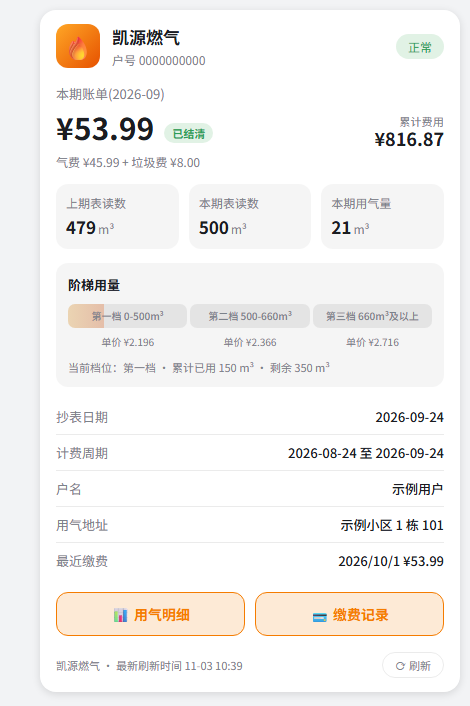
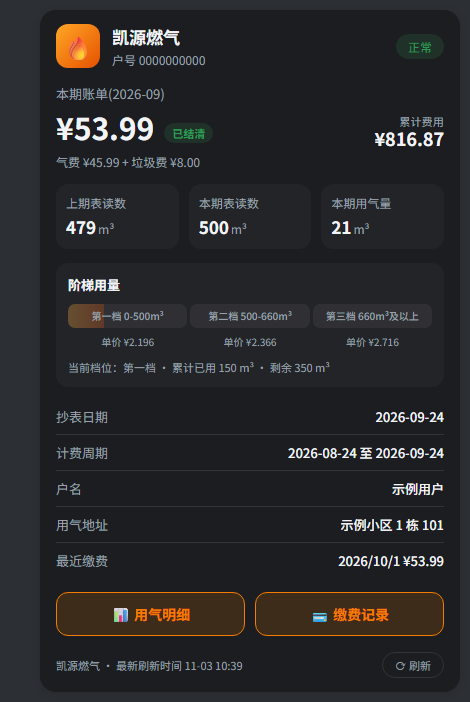
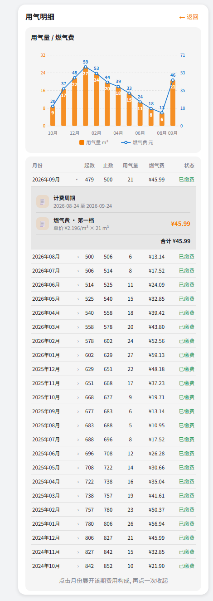
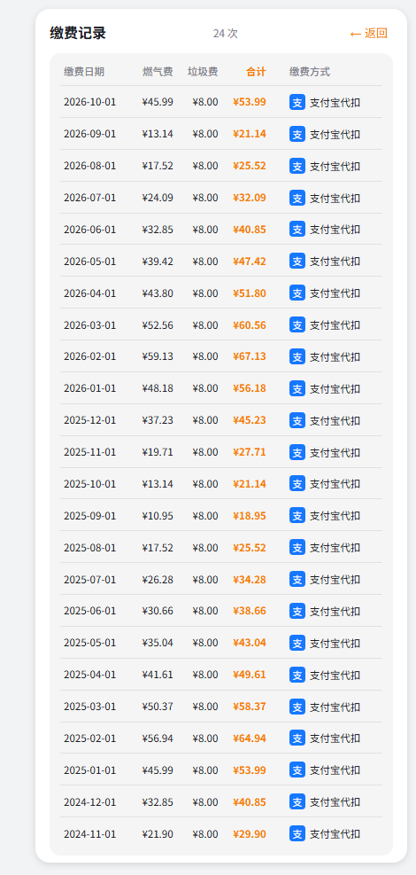
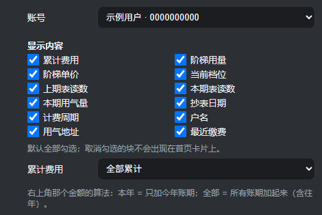

# 凯源燃气 Home Assistant 集成

[](https://github.com/hacs/integration)
[](LICENSE)

把「凯源燃气」微信公众号里的数据接进 Home Assistant，并自带一张 Lovelace 卡片：本期气费、三枚读数磁贴、
阶梯用量、逐期账期、缴费记录，一次装好就能看。

仓库：<https://github.com/ranqingwen/kaiyuan-gas>

> 非官方集成，与凯源燃气及其关联公司没有任何关系。只用于查询自己账号下的数据，请勿高频请求。

---

## ✨ 功能特性

- **UI 配置，一键添加**：手机号 + 密码即微信公众号那套登录方式，协议勾选、握手加密、户号识别全部由集成自动处理
- **12 个数据实体 + 3 个诊断实体**：本期气费 / 气量、上期与最新读数、本年累计用量、全部 / 本年累计费用、账单月份、缴费情况、最近缴费金额与时间等
- **本地缓存只增不删**：在线接口通常只回最近一年，缓存按账期和缴费日合并，用得越久历史越长；断网、被锁时自动回落缓存继续显示
- **自带 Lovelace 卡片**：主视图 + 用气明细（柱线图 + 账期表）+ 缴费记录，三处入口都在卡片里，随 HA 主题自动明暗
- **可视化编辑器**：12 项「显示内容」勾选（默认全开）+ 累计口径下拉（本年 / 全部），不用写 YAML
- **费用构成可展开**：点任意月份展开该期的「燃气费 · 第一档 单价 × 气量」明细；未结清账期按单价估算并标记
- **静默升级**：卡片随集成安装，集成启动时自动注册前端资源，`?v=` 指纹按卡片内容自动更新，升级只需覆盖文件夹
- **品牌图标**：`brand/` 自带 logo，HA 2024.4+ 在「添加集成」和设备页自动显示

## 🖼️ 界面预览

> 以下截图使用仓库内 `tools/demo_data.py` 生成的**模拟数据**，户名、户号、地址均为示例值。

| 主页（亮色） | 主页（暗色） |
| --- | --- |
|  |  |
| 本期账单、三枚读数磁贴、阶梯用量、抄表信息与两个入口 | 跟随 HA 主题自动切换深色，无独立配色 |
| **用气明细** | **缴费记录** |
|  |  |
| 用气量柱状 + 燃气费曲线双轴图，点月份展开该期费用构成 | 每笔缴费的气费 / 垃圾费 / 合计 / 扣款渠道 |
| **卡片编辑器** | |
|  | |
| 「显示内容」12 项勾选默认全开，下方可选累计口径（本年 / 全部） | |

## 📦 安装

### 方式 A：HACS（自定义仓库）

1. HACS → 集成 → 右上角 ⋮ → 自定义存储库
2. 地址填 `https://github.com/ranqingwen/kaiyuan-gas`，类别选「集成」
3. 搜索「凯源燃气」安装，重启 Home Assistant

### 方式 B：手动

把 `custom_components/kaiyuan_gas` 整个目录复制到 HA 的 `config/custom_components/` 下，重启 Home Assistant。

> 卡片就在这个目录里（`custom_components/kaiyuan_gas/www/kaiyuan-gas-card.js`），**不需要**再往 `config/www/` 复制，
> 也不需要手工添加前端资源——集成启动时会自动完成。
> **升级同理：覆盖 `custom_components/kaiyuan_gas` 整个文件夹、重启 HA 即可。**

依赖 `cryptography` 与 `requests`（HA 自带，`manifest.json` 已声明）。

## 🚀 快速开始

1. 设置 → 设备与服务 → 添加集成 → 搜索「凯源燃气」
2. 填手机号和密码，顺手确认阶梯气价（接口不返回分档标准，默认是重庆中心城区居民生活用气标准）
3. 添加完成后重启一次 HA（首次安装），之后直接添加卡片：可视化编辑器里会列出所有账号（显示为「户名 · 户号」）

```yaml
type: custom:kaiyuan-gas-card
entity: sensor.kaiyuan_ranqi_zui_xin_du_shu   # 主实体（最新读数），实际 ID 以你的为准
# hide: [cumulative, ladder, ladder_price, ladder_now, prev_reading, reading, usage, read_date, bill_period, name, address, last_pay]
# cum_scope: year   # 右上角累计费用只算今年；不写就是全部账期
```

只有一个账号时 `entity` 可以省略，卡片会自动选中；多账号又没指定时会提示去选。

## ⚙️ 配置说明

### 集成选项（集成 → 配置）

| 项 | 说明 |
| --- | --- |
| 账号 | 手机号，一般不用改 |
| 密码 | **留空表示不修改**；填写会先登录验证一次再保存 |
| 自动刷新间隔 | 滑条 12–48 小时，默认 24（气量一个月才变一次，刷太勤没意义） |
| 第一 / 第二档上限 | 年用气量分档线，m³/年 |
| 第一 / 二 / 三档气价 | 元/m³，卡片分档标注与阶梯进度都用它 |

默认阶梯气价（重庆中心城区居民家庭生活用气，可按当地标准改）：

| 档位 | 年用气量 | 气价 |
| --- | --- | --- |
| 第一档 | 0–500 m³（含） | 2.196 元/m³ |
| 第二档 | 500–660 m³（含） | 2.366 元/m³ |
| 第三档 | 660 m³ 以上 | 2.716 元/m³ |

### 实体

| 实体 | 含义 | 备注 |
| --- | --- | --- |
| `sensor.kaiyuan_ranqi_hu_hao` | 户号 | 属性带户名 / 地址 / 手机号 |
| `sensor.kaiyuan_ranqi_ben_qi_ying_jiao_jin_e` | **本期气费** | 元，只含这一期燃气费；含垃圾费 / 违约金的应缴总额在属性 `total_fee` |
| `sensor.kaiyuan_ranqi_ben_qi_yong_qi_liang` | **本期气量** | m³ |
| `sensor.kaiyuan_ranqi_lei_ji_fei_yong` | **全部累计费用** | 元，缓存里所有账期（含往年）「气费 + 垃圾费」之和 |
| `sensor.kaiyuan_ranqi_ben_nian_lei_ji_fei_yong` | **本年累计费用** | 元，只算账期落在今年的那些期 |
| `sensor.kaiyuan_ranqi_ben_nian_lei_ji_yong_liang` | **本年累计用量** | m³，跨年归零，故不用 `total_increasing` |
| `sensor.kaiyuan_ranqi_shang_qi_du_shu` | 上期读数 | m³，本期起数 |
| `sensor.kaiyuan_ranqi_zui_xin_du_shu` | 最新读数 | m³，**主实体**，卡片挂它，逐期账期 / 缴费记录 / 费用构成全在属性里 |
| `sensor.kaiyuan_ranqi_zhang_dan_yue_fen` | 账单月份 | 如 `2026-10`，属性带计费周期 |
| `sensor.kaiyuan_ranqi_jiao_fei_qing_kuang` | 缴费情况 | 已缴费 / 未缴费 |
| `sensor.kaiyuan_ranqi_zui_jin_jiao_fei_jin_e` | 最近缴费金额 | 元（气费 + 垃圾费 + 违约金） |
| `sensor.kaiyuan_ranqi_zui_jin_jiao_fei_shi_jian` | 最近缴费时间 | 公众号只有日期，没有时刻 |
| `sensor.kaiyuan_ranqi_shu_ju_lai_yuan` | 数据来源 | 诊断：在线获取 / 本地缓存 |
| `sensor.kaiyuan_ranqi_deng_lu_zhuang_tai` | 登录状态 | 诊断：在线 / 离线 |
| `sensor.kaiyuan_ranqi_zui_xin_shua_xin_shi_jian` | 最新刷新时间 | 诊断：最近一次在线刷新成功的时间，卡片右下角那行就是它 |

实体 ID 会随 HA 语言和命名规则变化，以实际为准；卡片自动查找主实体，不用手填。

> 设备页里实体的**显示顺序由 HA 前端决定**（按本地化名称拼音排序），集成无法指定。
> 想固定顺序只能用自定义 `entities` 卡片。

### 卡片配置

编辑器里的「显示内容」默认全部勾选，取消哪个首页就少哪一块；勾选状态存在卡片的 `hide` 数组里。

| key | 对应内容 |
| --- | --- |
| `cumulative` | 大数字右侧的「累计费用」 |
| `ladder` | 阶梯用量整块（标题 + 三档进度条 + 单价 + 当前档位；老配置 `show_ladder: false` 等价） |
| `ladder_price` | 阶梯块里的三个单价（三档一起） |
| `ladder_now` | 阶梯块里的「当前档位 · 累计已用 · 剩余」 |
| `prev_reading` | 上期表读数磁贴 |
| `reading` | 本期表读数磁贴 |
| `usage` | 本期用气量磁贴 |
| `read_date` | 抄表日期 |
| `bill_period` | 计费周期 |
| `name` | 户名 |
| `address` | 用气地址 |
| `last_pay` | 最近缴费 |

右上角累计费用有两个口径，编辑器里用下拉框切换：

| `cum_scope` | 含义 | 卡片标签 |
| --- | --- | --- |
| 不写 / `all` | 所有账期加起来（含往年），默认 | `累计费用` |
| `year` | 只加今年账期，与阶梯用量同一年度口径 | `本年累计` |

## 🗂️ 本地缓存

位置：`config/kaiyuan_gas_info_<户号>.json`（普通 JSON，可手工编辑，改完重载集成生效）。

- `billList` 以账期为键、`rechargeList` 以缴费日为键，**只增不删**；同一键用新值覆盖非空字段（例如「未缴费」变「已缴费」）
- 在线没返回的旧账期原样保留，所以用得越久历史越长；换账号时删掉旧文件即可重来
- 在线成功：合并 → 写盘 → 实体属性取自合并结果；在线失败：直接用文件内容，`数据来源 = 本地缓存`，`last_error` 保留原因
- 样例结构见 [`tools/demo_cache.json`](tools/demo_cache.json)（全部为合成数据）

## 🔧 接口与实现

查询走微信公众号 H5（`wx.kaiyuan.qjcode.com`）的同一套接口，请求与响应均加密：

- 握手：`POST /api/sec/serverKey`，RSA-PKCS1v15 交换 AES-ECB-PKCS7 对称密钥
- 请求头需带 `part: WECHAT`、握手 `secret`、登录 `token`、`fromDomainId: 3000000036`（缺这个头业务接口统一返回 `code=999`）
- 业务接口：`doLoginByPwd`、`getUserInfo`、`ncBill`、`accountInfo`、`arrearage`、`feeRecord`、`feeDetail`、`payMentRecord`、`mrInfo`

几个踩过的字段坑：`payableGasFee` 是「应收金额」而非真金，真实气费取 `billAmt`；未结清账期没有费用构成，
按单价估算并打 `estimated` 标记；缴费记录服务端一页只回 5 条，需按 `totalCount` 翻页。

## 🛠️ 项目结构

```
custom_components/kaiyuan_gas/   集成本体（api / coordinator / cache / sensor / config_flow / www 卡片）
docs/                            文档截图（模拟数据）
tools/selftest.py                离线自检（不需要账号）
tools/demo_data.py               生成演示数据 + 刷新 preview.html
tools/ky_probe.py                对着真实账号 dump 接口返回（排查字段变化）
preview.html                     静态预览页，浏览器直接打开可看卡片效果
```

```bash
python tools/selftest.py          # 离线自检
python tools/demo_data.py         # 重新生成演示数据与静态预览
```

## ❓ 常见问题

**提示「账号已被临时锁定」？**
服务端有失败次数限制，触发后通常锁 24 小时，锁定期内**不要反复重试**，会延长锁定；期间集成继续用缓存展示。

**实体在刷新，卡片右下角时间不动？**
1.0.17 起已修：页脚取「刷新时间 / 数据时间 / 缓存时间」中较新的那个。若仍停住，说明在线查询一直失败（右侧会显示「离线」，日志里有「在线查询失败…改用本地缓存」）。

**卡片显示「请选择账号」或空白？**
多账号又没指定 `entity` 时会这样。编辑卡片，从「账号」下拉框选一个即可。

**为什么有些月份没有垃圾费 / 缴费记录为空？**
部分早期账期确实只收气费；如果这户没有网厅缴费记录，公众号里同样是空的，不是漏抓。

**接口改版了怎么办？**
用 `tools/ky_probe.py` dump 一份原始 JSON，对比 `coordinator.py` 里的候选字段名，补上新键即可。

## ⚠️ 免责声明

- 本项目为个人自用工具，与凯源燃气及其关联公司无关
- 接口为客户端私有接口，可能随时变更或关闭，不保证长期可用
- 请勿高频请求，默认 24 小时刷新一次是有意为之
- 因使用本项目造成的一切后果由使用者自行承担

## 📄 License

[MIT](LICENSE) © 2026 [ranqingwen](https://github.com/ranqingwen)
